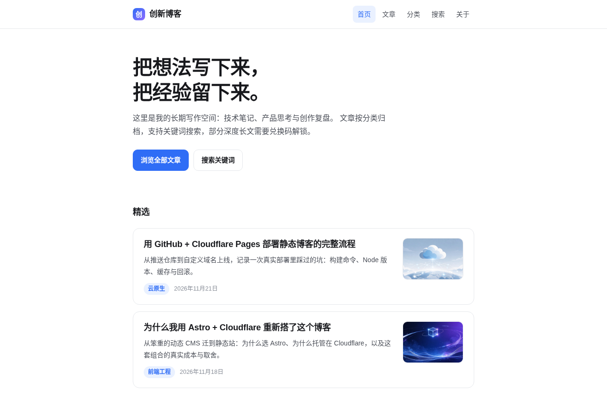
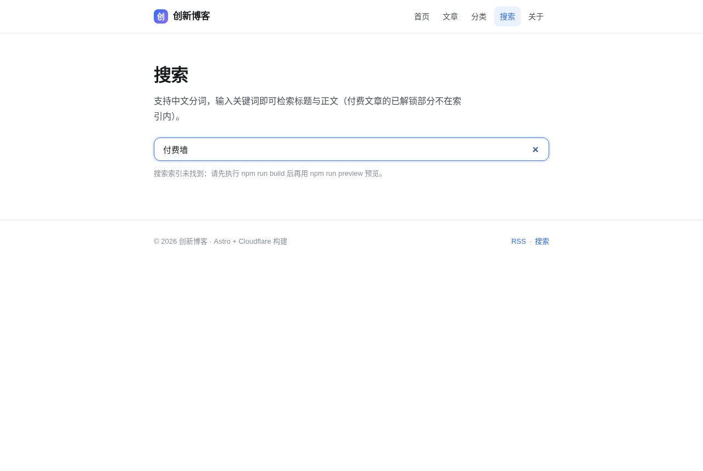
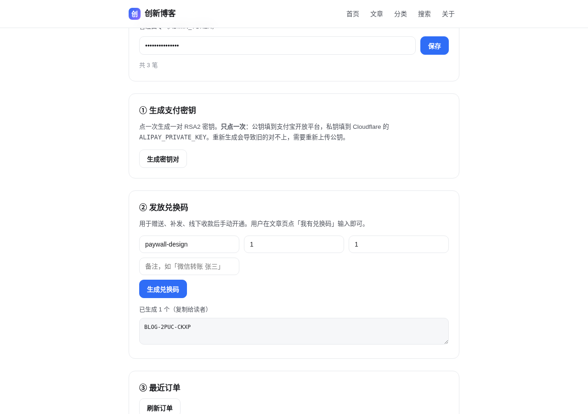

# 创新博客

用 **Astro + Cloudflare Pages + Cloudflare Worker + D1** 搭的静态博客：图片、分类、中文全文搜索、付费阅读（支付宝当面付扫码）。
内容写在 Markdown 里，推到 GitHub 自动部署。



## 能做什么

| 能力 | 实现方式 |
| --- | --- |
| 写文章 | `src/content/posts/*.md`，frontmatter 带 Schema 校验 |
| 放图片 | 图片丢进 `public/images/`，正文写 `` |
| 分类 | frontmatter 的 `category`，中文自动转拼音做 URL |
| 关键词搜索 | 构建期 Pagefind 生成索引，中文分词 + 分类筛选 |
| 付费阅读 | 免费看前半段；付款后正文从 D1 取回，静态页面里根本没有 |
| 收费 | 支付宝当面付扫码，异步通知 + 前端轮询双通道确认，自动解锁 |
| 备选授权 | 兑换码（赠送、补发、线下收款），管理页一键生成 |
| RSS / sitemap | `/rss.xml`、`sitemap-index.xml` |

## 架构

```
读者浏览器
   │
   ├─ 静态页面（首页/文章/分类/搜索）      ← Cloudflare Pages（构建产物 dist/）
   │     └─ 付费文章只有免费预览
   │
   └─ Cloudflare Worker ──→ D1（articles / orders / codes）
        ├─ POST /api/pay/create   下单，返回二维码
        ├─ GET  /api/pay/status   轮询，付款成功签发令牌
        ├─ POST /api/pay/notify   支付宝异步通知（RSA2 验签）
        ├─ POST /api/unlock       兑换码换令牌
        ├─ GET  /api/article      验令牌取付费正文
        └─ GET  /api/admin/*      生成密钥 / 发码 / 看订单
```

关键设计：**付费正文从不进入静态页面**，右键看源码、Ctrl+F 都拿不到。
前端只缓存一张 30 天有效的签名令牌（localStorage，按文章分开存），换设备需要重新付款或用兑换码补发。


## 目录结构

```
├─ src/
│  ├─ content/posts/        文章（Markdown）
│  ├─ lib/                  配置、Markdown 渲染、文章工具
│  ├─ components/           Header / Footer / PostCard / Paywall
│  ├─ pages/                首页、文章、分类、搜索、关于、admin、rss.xml
│  └─ styles/global.css
├─ public/images/           图片与封面
├─ scripts/
│  ├─ sync-paid.mjs         把付费正文推进 D1（构建后自动跑）
│  └─ new-post.mjs          新建文章骨架
├─ worker/                  Cloudflare Worker
│  ├─ src/index.ts          路由与业务
│  ├─ src/alipay.ts         当面付签名 / 验签 / 网关调用
│  ├─ src/crypto.ts         HMAC 令牌、IP 哈希、券码生成
│  ├─ schema.sql            D1 建表（articles / orders / codes）
│  └─ wrangler.toml
├─ .github/workflows/       推送即部署：建表 → 同步付费正文 → 部署 Worker
└─ docs/screenshots/        文档用截图
```

## 部署（全程网页，不用命令行）

见 **[部署指南.md](部署指南.md)**。八个步骤全在浏览器里点：

1. 代码上传 GitHub
2. 建 D1 数据库
3. 建 API Token
4. 填两个 GitHub Secret
5. Actions 一键部署后端
6. Cloudflare 后台设密钥
7. 建 Pages 站点
8. 开通支付宝当面付

## 写文章

**普通文章**：在 `src/content/posts/` 新建 `.md` 即可。

**付费文章**：frontmatter 加 `paid: true` 和 `price`，正文插 `<!--more-->`：

```markdown
---
title: 一篇付费长文
date: 2026-11-23
category: 技术实践
paid: true
price: 9.9
---

这几段免费试读，会进搜索索引。

<!--more-->

这行以下是付费正文，只存在于 D1。
```

推送后 workflow 会自动把付费正文同步进数据库。

frontmatter 字段：

| 字段 | 必填 | 说明 |
| --- | --- | --- |
| `title` | 是 | 标题 |
| `date` | 是 | 发布时间，`2026-11-25` |
| `description` | 建议 | 列表与搜索里的摘要 |
| `category` | 否 | 分类名，默认「未分类」 |
| `categorySlug` | 否 | 自定义分类 URL，不填则中文转拼音 |
| `tags` | 否 | 标签数组 |
| `cover` | 否 | 封面，`/images/xxx.jpg` |
| `paid` | 否 | `true` 为付费文章 |
| `price` | 否 | 价格（元），**后端以此为准，前端改价无效** |
| `featured` | 否 | `true` 进首页「精选」 |
| `draft` | 否 | `true` 只在开发环境可见 |

## 图片

放进 `public/images/`（建议 1600×900、JPEG 质量 80、100KB 左右）。
正文写 ``，封面在 frontmatter 写 `cover: /images/xxx.jpg`。
走 Pages 的 CDN，量特别大可以再接 R2。

## 分类与搜索

- `category: 前端工程` + `categorySlug: frontend` → `/categories/frontend/`
- `category: 读书笔记`（不写 slug）→ `/categories/du-shu-bi-ji/`
- 搜索用 Pagefind 在 `npm run build` 时扫 `dist/` 建索引，只有带 `data-pagefind-body` 的页面被索引；分类通过 `<meta data-pagefind-filter="category[content]">` 注入筛选。
- 付费文章的付费部分不参与搜索——它从未进过静态页面。



## 付费与授权

**支付宝当面付**

- 下单金额取自 D1 里的 `articles.price`，不信前端提交的金额。
- 签名：RSA2（SHA-256 with RSA），PKCS#1 与 PKCS#8 私钥都支持，兼容支付宝密钥工具导出的裸 base64。
- 确认有两条路：异步通知（`/api/pay/notify`，剔除 `sign`/`sign_type` 后验签）+ 前端每 2.5 秒轮询 `query` 接口。任一条先到就解锁，通知幂等（重复通知不会重复写）。
- 轮询有 3 秒缓存节流，避免刷爆支付宝接口配额。
- `ALIPAY_MOCK="1"` 时跳过真实下单，15 秒后自动认为已付，**上线前必须删掉**。

**兑换码（备选）**

- `scope=article` 只解一篇，`scope=all` 通兑；支持 `maxUses`、`expiresAt`、`revoke`。
- 令牌 HMAC-SHA256 签名，默认 30 天。
- 同一 IP 10 分钟内失败 10 次拒绝，只存 IP 哈希。
- 付费正文响应固定 `private, no-store`，不会被 CDN 缓存串号。

## 管理页

`/admin/`：填管理口令后可以**生成支付密钥对、批量发兑换码、查看订单**，全部在浏览器里完成。



## 本地开发（可选，作者自己看）

```bash
npm install && npm run dev          # 站点，localhost:4321
npm --prefix worker install
cd worker && printf 'TOKEN_SECRET=本地32位以上\nADMIN_TOKEN=本地口令\n' > .dev.vars
npx wrangler d1 execute innovate-blog --local --file=schema.sql
npx wrangler d1 execute innovate-blog --local --file=paid-articles.sql
npx wrangler dev --port 8787
```

前端 `.env` 写 `PUBLIC_BLOG_API=http://localhost:8787`。
搜索索引只在构建产物里，验证搜索要用 `npm run build && npm run preview`。

## 常见问题

**搜索提示「索引未找到」** → 用 `npm run preview`，`dev` 模式没有索引。

**付费正文 404「文章不存在，可能尚未同步」** → 付费正文没进 D1，检查 Actions 的「同步付费正文」这一步。

**本地能解锁、线上不行** → 检查 Pages 环境变量 `PUBLIC_BLOG_API`，以及 `wrangler.toml` 的 `ALLOWED_ORIGINS` 是否包含站点域名。

**想全站免费** → 去掉 `paid: true`，把 `<!--more-->` 之后的内容并回正文。

更多见 [部署指南.md](部署指南.md) 第 11 节。
